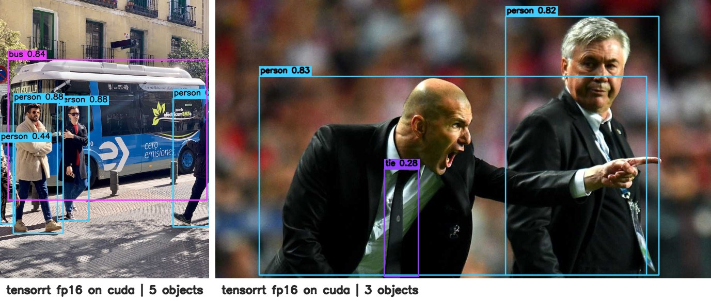

# Vision Inference Microservice

[](https://github.com/nati2126/vision-inference-microservice/actions/workflows/ci.yml)
[](https://www.python.org/downloads/)
[](https://fastapi.tiangolo.com/)
[](LICENSE)

A YOLOv8 object-detection API that runs on **PyTorch, ONNX Runtime, OpenVINO or
TensorRT**: one environment variable switches the engine, and the API stays the
same. Every engine is measured for speed and accuracy on the same machine.



*Boxes drawn from the API's JSON response, with TensorRT serving. Regenerate
with `python -m scripts.render_demo a.jpg b.jpg --url http://localhost:8000`.*

## Results at a glance

yolov8n on one laptop (Intel i9-14900HX, RTX 4070 Laptop GPU). Latency is one
640x480 image, end to end. Accuracy is the full COCO val2017 set (5,000
images), scored by pycocotools.

| Engine | Device | Precision | Latency (p50) | Accuracy (mAP50-95) |
|---|---|---|---:|---:|
| TensorRT | GPU | FP16 | **4.0 ms** | 0.367 |
| PyTorch | GPU | FP32 | 14.4 ms | 0.367 |
| ONNX Runtime | GPU | FP32 | 15.9 ms | 0.367 |
| OpenVINO | CPU | INT8 | 33.7 ms | 0.356 |
| ONNX Runtime | CPU | FP32 | 40.9 ms | 0.367 |
| OpenVINO | CPU | FP32 | 45.5 ms | 0.367 |
| ONNX Runtime | CPU | INT8 | 51.3 ms | 0.356 |
| PyTorch | CPU | FP32 | 73.0 ms | 0.367 |

## Highlights

- **18x faster than PyTorch on the CPU, with the same accuracy.** TensorRT runs
  the model in FP16, and the image preparation and box filtering run on the
  GPU too. That move alone cut latency from 11 ms to 4–5 ms.
- **INT8 that works.** Quantising the whole model scores 0.000 mAP, because box
  coordinates and class scores share one tensor and every score rounds to
  zero. Keeping the last layers in FP32 fixes it: a 3.6x smaller file for
  0.011 less mAP.
- **Stays responsive under overload.** Past 64 requests in flight, the API
  answers 503 instead of queueing. With 256 clients, the median request took
  1.9 s instead of 7.2 s.
- **Batches requests automatically** when they queue up: 16–23% more
  throughput for ONNX Runtime on the CPU, without delaying a request that
  arrives alone.
- **Checked against references.** The NumPy post-processing matches
  ultralytics bit for bit, and the mAP code matches pycocotools to 1e-6. CI
  runs linting, strict type checks, tests and a Docker build.

## Quick start

```bash
git clone https://github.com/nati2126/vision-inference-microservice.git
cd vision-inference-microservice
python -m venv .venv
source .venv/bin/activate          # Windows: .venv\Scripts\activate
pip install -r requirements.txt
cp .env.example .env
uvicorn app.main:app               # PyTorch on the CPU
```

Detect objects in an image:

```bash
curl -X POST http://localhost:8000/api/v1/detect -F "file=@image.jpg"
```

```json
{
  "detections": [
    {"label": "person", "confidence": 0.9231,
     "bbox": {"x_min": 45.12, "y_min": 102.34, "x_max": 320.56, "y_max": 489.78}}
  ],
  "metadata": {"image_width": 640, "image_height": 480,
               "inference_time_ms": 42.15, "detections_count": 1}
}
```

Switch to another engine:

```bash
python -m scripts.export_models    # builds the ONNX, OpenVINO and TensorRT files
MODEL_BACKEND=onnxruntime MODEL_PATH=models/yolov8n.onnx uvicorn app.main:app
```

Or with Docker: `make docker-up`. Interactive API docs are at
[`/docs`](http://localhost:8000/docs).

## Learn more

- [**Benchmarks**](docs/benchmarks.md): every table (latency, memory, batching,
  HTTP throughput, COCO accuracy) and how to reproduce them.
- [**Design**](docs/design.md): how it works, the decisions behind it, and its
  limitations.
- [**API and configuration**](docs/api.md): every engine, endpoint, metric and
  setting.

## Development

```bash
make lint             # ruff
make typecheck        # mypy --strict
make test             # pytest
make export           # python -m scripts.export_models
make benchmark        # full benchmark
make benchmark-quick  # smoke benchmark
```

The tests export `models/yolov8n.{pt,onnx}` on first run. Tests for backends
whose package, artifact or GPU is missing are skipped with the reason.

## License

MIT
